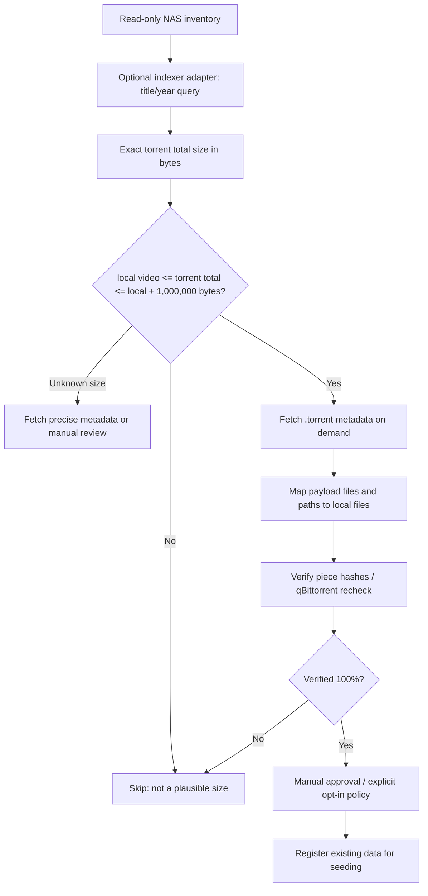

# Movana cross-seed module — design and safety

**Status: candidate size prefilter implemented, no network integration or torrent changes.**

## Goal

Discover whether already-owned local media files could match a torrent listed by a configured external indexer such as C411, **without re-downloading the media payload**. This is an optional component and should never block normal browsing or library scans. Use only where distribution is authorized and permitted by the tracker.

## Infrastructure

Cross-seed is a separate **module/job pipeline** inside the Movana application, not an obligatory Docker container or a service required to start the application.



## Size rule

Default: a remote torrent is a prefilter candidate **only if**:

```text
local_file_bytes <= torrent_total_bytes <= local_file_bytes + 1_000_000
```

1 MB means **1,000,000 bytes** (decimal). The allowance accounts for typical small text metadata such as NFO/SFV/TXT. External subtitles and video samples are **not explicitly supported** in this initial design.

A torrent smaller than the video cannot contain the complete unchanged local video. A torrent much larger may contain additional content, but is rejected by this fast-path rule intentionally. A source that exposes only rounded display sizes must not be treated as providing an exact byte count.

The current filter is in `app/crossseed/matching.py`. It never hashes, mutates, queries trackers or adds torrents.

## Planned matching process

1. Use the library's identified movie/series/episode title only to retrieve possible indexer hits, with pagination, caching and rate limiting.
2. Apply exact size prefilter before fetching detailed metadata.
3. Parse .torrent metadata and match the full payload layout, allowing renamed local paths only where mapping can be confirmed.
4. Verify bytes/pieces using a trusted compatible engine. **Title and size are never sufficient** to seed.
5. Detect torrents already registered. If no compatible full match, do not enable seeding; prevent unwanted downloads.
6. Log the decision, source evidence, and final verification result. Apply user-approved policies only after safe dry-runs.

## Resource goals

- Do not read or hash every file in a library.
- Run candidate checks in small batches, with a bounded work queue.
- Keep API credentials on the server and use caches to honor indexer rate limits.
- Keep the feature off by default until end-to-end tests prove there is no accidental downloading or corrupted state.

## Future interfaces

- `IndexerAdapter`: search query, exact size, metadata link, rate limits.
- `TorrentPayloadInspector`: file/path/size mapping.
- `VerificationAdapter`: complete piece hash verification without unwanted download.
- `TorrentRegistrationAdapter`: qBittorrent duplicate detection, controlled add/pause/recheck/seed.
- `JobStore`: durable, resumable operations in PostgreSQL.

Only the pure size matching function exists today. The adapter contracts are deliberately deferred until C411 documentation and the qBittorrent deployment have been checked.
