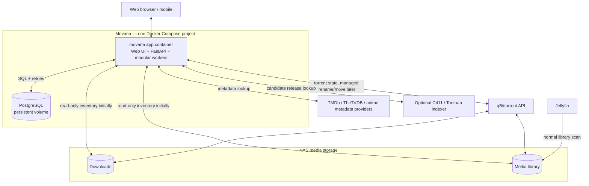
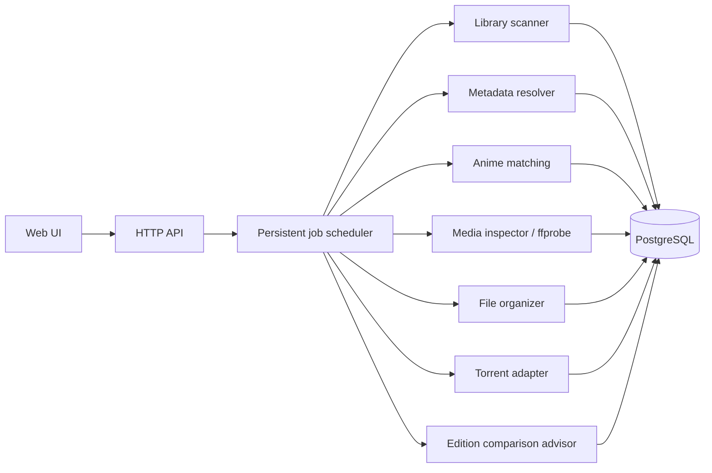
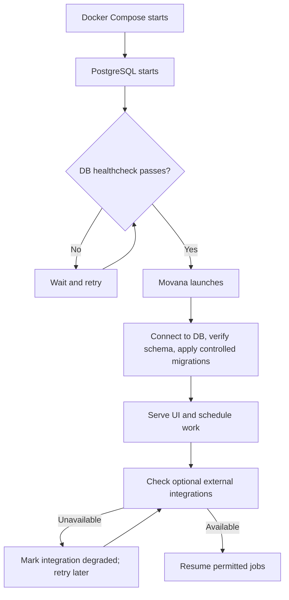
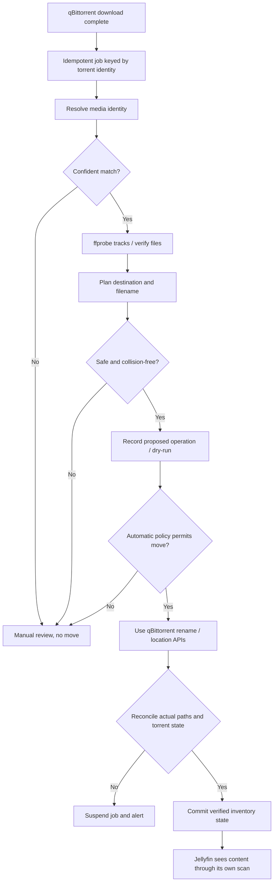

# Movana — Architecture (proposed)

> **Status: design proposal, not implemented yet.** This document describes our target architecture for the first releases. Actual deployment and API behavior must be validated before enabling filesystem writes.

Movana is a self-hosted media library inventory and automation platform, designed for Docker-compatible NAS systems. The Windows MediaCleanarr client remains a separate project. Jellyfin and qBittorrent remain independent applications.

## Infrastructure and integrations

The **initial alpha mounts media read-only**. Filesystem mutations and qBittorrent-controlled moves are future, explicitly tested features. For torrent-managed content, prefer qBittorrent's own APIs for renaming and changing save locations; do not rename its files out-of-band.

## Internal modules

Each module has its own contract, tests, and error handling. Modules may share one process in the initial app container, but must remain separable later. The database is the authoritative record of identities and job state, **not** proof of the current location of a file until reconciled.

## Startup and outage recovery

Compose `depends_on: condition: service_healthy` helps at initial startup only. Movana must **also** retry DB connections after restarts, report readiness separately from liveness, and treat qBittorrent, Jellyfin, metadata providers and C411 as optional integrations that never prevent the UI from starting. Database outage must suspend state-changing jobs.

## Download-complete processing (future phase)

For multi-file torrents, paths may need per-file operations. Moves across filesystems may involve copying and a longer transition, and must not be treated as atomic. No content deletion or replacement without validation. A restart or duplicate event must never produce two relocations.

## Suggested persistent data model

- **MediaWork**: movie, series, anime and canonical provider IDs.
- **Edition**: an identifiable release/version of a work.
- **PhysicalFile**: path, size, timestamps, container and available checksums.
- **Track**: detected audio, subtitle and video properties (measured by ffprobe).
- **TorrentAssociation**: qBittorrent hash, file index, save path and observed state.
- **Job / OperationLog**: work state, idempotency key, attempted action, outcome and reconciliation evidence.
- **ReleaseCandidate**: external catalog/indexer suggestion, *unverified* until independently checked.

This prevents us from conflating a movie, a particular edition, a physical file and a torrent.

## Contribution and change boundaries

New providers should implement a documented adapter interface, return normalized results, respect rate limits and support unavailable-provider behavior. New operations must support dry-run, collision checks, durable audit logging, and explicit tests for failure/restart cases.

See [CONTRIBUTING.md](../CONTRIBUTING.md) and [ROADMAP.md](ROADMAP.md).