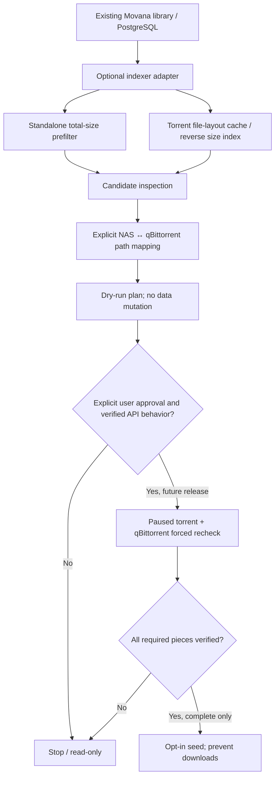

# Cross-seed research: TorrentLinker

Reference: [Vietnoirien/TorrentLinker](https://github.com/Vietnoirien/TorrentLinker) (reviewed 2026-11-10). Architectural ideas only; **no third-party source code copied**. The repository currently has no declared GitHub license, so do not reuse code without permission.

## Lessons for Movana

1. **Path reconciliation, not disk mutations.** TorrentLinker [ADR-0002](https://github.com/Vietnoirien/TorrentLinker/blob/main/docs/adr/0002-reseed-by-renaming-inside-qbittorrent.md) describes mapping target torrent paths to existing on-disk files through qBittorrent's own per-file rename API. This could avoid hardlinks, duplicate folders, and renames on the NAS. This is a future opt-in integration, not part of today's read-only runtime. Confirm API semantics using our own container sandbox first.

2. **Unified path mappings.** [ADR-0006](https://github.com/Vietnoirien/TorrentLinker/blob/main/docs/adr/0006-one-list-of-path-mappings-detected-from-qbittorrent.md) treats Movana/NAS paths and qBittorrent paths as different namespaces, with one explicit prefix map. Example: Movana sees `/media/Films/Movie.mkv` while qBittorrent may see `/downloads/Films/Movie.mkv`. Never assume Docker mounts match; verify before a torrent is registered.

3. **Index the file layout, not just torrent totals.** [Research on TorrentMatch](https://github.com/Vietnoirien/TorrentLinker/blob/main/docs/research/torrentmatch-techniques.md) recommends a reverse index of individual files within previously fetched torrent metadata, with exact sizes. It enables finding a single TV episode inside a season pack whose *total* torrent size exceeds the episode. Our current `local_size .. local_size + 1_000_000` filter should remain **the fast path for single-film / standalone matches**, but cannot determine whether a file occurs in a larger pack.

4. **Explicit match states.** At minimum: `candidate`, `layout_plausible`, `full_payload_match`, `partial_payload_match`, `hash_verified`, `rejected`, `already_registered`. A size match is NEVER a verified torrent.

5. **Partial matches need stricter safeguards.** [ADR-0018](https://github.com/Vietnoirien/TorrentLinker/blob/main/docs/adr/0018-seed-partial-matches-with-every-file-skipped.md) describes setting *all* torrent files to priority 0 before starting a partial seed and re-reading priorities to confirm nothing is wanted. This is client/version-sensitive, and a changed priority could re-enable downloads. For Movana **partial matches remain inspection-only** until tested in a disposable qBittorrent environment with download traffic monitoring. Do not assume all-skipped torrents seed safely across versions.

6. **Durable decision history.** Remember candidates rejected by the user, verified torrent hashes, file mtime/size/fingerprint at verification, and duplicate torrent detection. Invalidate positive verification when local files change. Limit concurrent checks to avoid saturating a NAS.

## Intended architecture

## Scope and next steps

- Stay inside the existing Movana application container and PostgreSQL container; no mandatory external worker/container.
- Store torrent layouts and path maps only after adding migrations, durability, and bounded cache retention.
- Implement an **offline-only** proof of concept first: given a set of local `(path, size)` pairs and a fictional torrent file manifest, show match coverage without touching disks or qBittorrent.
- Preserve the independent user decision that Movana remains **read-only for media until production**, including no automatic torrent registration, move, rename, or hardlink.
- Do not incorporate TorrentLinker's extensive downloader, AI assistant, reward planning, archive extraction, or upload functions into the near-term Movana scope.
